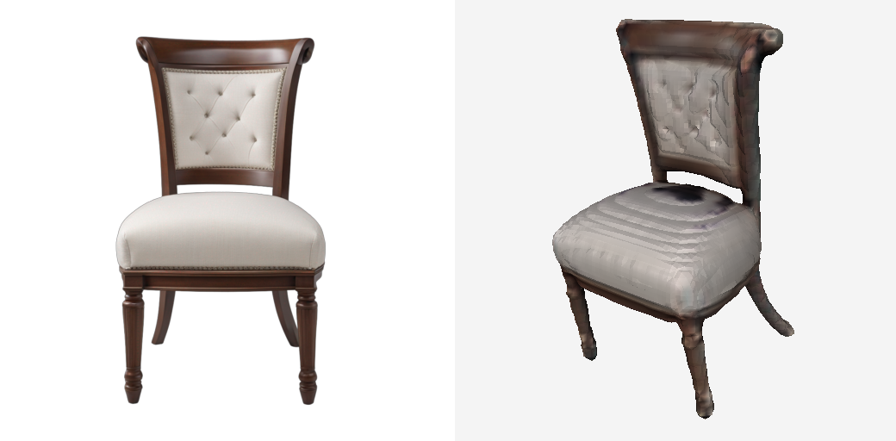

`TripoSRRuntime` loads `triposr_swift_ready.safetensors` and runs an RGB image through an MLX Swift port of TripoSR, returning triplanes plus density and color. It does not extract a mesh.

## Install

There is no version tag yet. Depend on the `main` branch. The package identity is the repository name. You need read access to this repository.

```swift
// swift-tools-version: 6.2
import PackageDescription

let package = Package(
    name: "Example",
    platforms: [
        .macOS(.v14),
        .iOS(.v17),
        .visionOS(.v1),
    ],
    dependencies: [
        .package(url: "https://github.com/signalnotnoise/triposr-mlx-swift.git", branch: "main"),
    ],
    targets: [
        .target(
            name: "Example",
            dependencies: [
                .product(name: "TripoSRRuntime", package: "triposr-mlx-swift"),
            ]
        ),
    ]
)
```

Products:

| Product | Kind |
| --- | --- |
| `TripoSRRuntime` | Library. Import this. |
| `TripoSRCLI` | Executable. Smoke forward pass and optional parity dump. |

`mlx-swift` is capped at `0.31.3..<0.31.5` in `Package.swift`. The source package's lockfile selected `0.31.3`, and `0.31.4` is the last release that still builds with this manifest. Starting with `0.31.5`, `mlx-swift` sets `swift-tools-version` to 6.3. This package stays on Swift tools 6.2, so the range stops before `0.31.5` and SwiftPM will not select a dependency this manifest cannot resolve.

## Usage

```swift
import MLX
import TripoSRRuntime

let model = TripoSRModel()
try model.loadWeights(from: weightsURL)

// image: [batch, height, width, 3] float RGB in [0, 1], NHWC.
// ImageNet mean and std are applied inside forwardTriplanes.
let triplanes = model.forwardTriplanes(image: image)

// positions: [batch, pointCount, 3], roughly inside radius 0.87.
let (density, color) = model.evaluate(triplanes: triplanes, positions: positions)
```

`loadWeights(from:)` reads a `.safetensors` file, checks tensor shapes, and rejects unused keys. A missing file throws.

`TripoSRCLI` looks for weights in this order: `TRIPOSR_WEIGHTS_PATH`, `./triposr_swift_ready.safetensors`, `./triposr_weights/triposr_swift_ready.safetensors`, then the older monorepo relative paths. If none exist, the smoke command prints `Failed:` and exits nonzero. Any other smoke failure also exits nonzero. `--parity` needs `parity/image.npy` and `parity/positions.npy` (or another directory `resolveParityDir` already finds). If those files or the weights are missing, it prints `Failed:` and exits nonzero. The Python scripts that write those dumps are not in this repository. The runtime result is density and color, not a mesh.

## Weights

Download the canonical file from [signalNotNoise/triposr-mlx](https://huggingface.co/signalNotNoise/triposr-mlx) and check the SHA-256 before calling `loadWeights`. The Hub commit recorded for this extraction is `76f3028746d0b5f39b6ba0205ede9e28835f106d`. That commit's `checksums.sha256` lists:

```text
83563625f39180f505a3ccb855e67b59b65989f6545015672465d7487c4bc2cb  triposr_swift_ready.safetensors
```

The file is 1,674,793,528 bytes. It is not in this git repository.

```bash
revision=76f3028746d0b5f39b6ba0205ede9e28835f106d
curl -L -o triposr_swift_ready.safetensors \
  "https://huggingface.co/signalNotNoise/triposr-mlx/resolve/${revision}/triposr_swift_ready.safetensors"
curl -L -o checksums.sha256 \
  "https://huggingface.co/signalNotNoise/triposr-mlx/resolve/${revision}/checksums.sha256"

# One-file check of the weights the Swift loader accepts:
echo "83563625f39180f505a3ccb855e67b59b65989f6545015672465d7487c4bc2cb  triposr_swift_ready.safetensors" | shasum -a 256 -c -

# Bundle check (every file named in checksums.sha256, including the weights):
grep 'triposr_swift_ready.safetensors$' checksums.sha256 | shasum -a 256 -c -
```

`shasum -a 256 -c` exits non-zero when the digest does not match. Do not load a file that fails the check.

To run the optional weight test, point `TRIPOSR_WEIGHTS_PATH` at the verified file. That test only calls `loadWeights(from:)` and does not run a forward pass. If that variable is unset and the file is not in the working directory, the test is skipped. `TripoSRRuntime` outputs density and color. It does not output a mesh.

## Platforms

`Package.swift` declares macOS 14, iOS 17, and visionOS 1.

What this repository's CI actually runs: one macOS job on `macos-26`, using the image's default Xcode (Swift 6.2 or newer) and `xcodebuild`. The job builds `TripoSRCLI` and runs `TripoSRRuntimeTests`. It does not download the weights, so `loadWeightsFromPublishedFileWhenPresent` is skipped there. It does not build an iOS or visionOS destination.

`swift build` and `swift test` are not the CI path. mlx-swift compiles Metal shaders and bundles `default.metallib` through Xcode. The unit tests set the MLX default device to CPU, and they still need that Metal library to load.

Build and test locally:

```bash
xcodebuild build \
  -scheme TripoSRCLI \
  -destination 'platform=macOS' \
  -skipPackagePluginValidation \
  CODE_SIGNING_ALLOWED=NO

xcodebuild test \
  -scheme TripoSR-Package \
  -destination 'platform=macOS' \
  -skipPackagePluginValidation \
  -parallel-testing-enabled NO \
  CODE_SIGNING_ALLOWED=NO
```

## Tested on

Apple M3 Max (Mac15,11, 14 cores: 10 performance and 4 efficiency, 36 GB unified memory), macOS 27.3 (build 26C5047e), Xcode 27.0 (build 27A5252f) at `/Applications/Xcode-beta.app`. The installed Metal toolchain build was 27A5252f. `xcodebuild` resolved `mlx-swift` 0.31.4. The runs below used Debug, the default `xcodebuild` configuration. The runtime and CLI sources were commit `7655b26`.

`xcodebuild test -scheme TripoSR-Package -destination 'platform=macOS'` with `TEST_RUNNER_TRIPOSR_WEIGHTS_PATH` set to the checked weights file: 6 tests in 2 suites passed in 0.773 seconds. `loadWeightsFromPublishedFileWhenPresent` passed in 0.041 seconds. `smokeExitsNonzeroWhenWeightsAreMissing` passed in 0.690 seconds. The runtime tests set the MLX default device to CPU. A shell `TRIPOSR_WEIGHTS_PATH` alone did not reach the test process; the `TEST_RUNNER_` prefix did.

Weights: `triposr_swift_ready.safetensors` from [signalNotNoise/triposr-mlx](https://huggingface.co/signalNotNoise/triposr-mlx) commit `76f3028746d0b5f39b6ba0205ede9e28835f106d`, 1,674,793,528 bytes, kept outside this checkout. `shasum -a 256 -c` matched `83563625f39180f505a3ccb855e67b59b65989f6545015672465d7487c4bc2cb`.

`TripoSRCLI` smoke on MLX `Device(gpu, 0)`, random 512×512 RGB, `Memory.cacheLimit` 512 MiB as the CLI sets it. `/usr/bin/time -l`: 0.75 seconds real, maximum resident set size 1,733,754,880 bytes, peak memory footprint 2,231,355,360 bytes. Printed triplanes `[1, 3, 64, 64, 40]`, density min 0.08230684 and max 2572.311, color min 0.2522956 and max 0.6929118. Metal kernels were already cached on this machine from the chair run below.

Real image: [`examples/chair.png`](https://github.com/VAST-AI-Research/TripoSR/blob/e82c7a2ecf89a00a9324312ce30ec38a1f304fe9/examples/chair.png) from VAST-AI-Research/TripoSR commit `e82c7a2ecf89a00a9324312ce30ec38a1f304fe9`, git blob `fee2a21d1c9bbdf707631060f110539401265a1d`. That repository is MIT, Copyright (c) 2024 Tripo AI & Stability AI. The file is 512×512 RGBA with alpha from 0 to 255. A local harness outside this package composited it onto gray 0.5 and called `forwardTriplanes` with `[1, 512, 512, 3]` float RGB. `MTLCreateSystemDefaultDevice()` reported Apple M3 Max. MLX device was `Device(gpu, 0)`. The harness left the default MLX cache limit, which read 36,721,970,380 bytes.

| Phase | Seconds |
| --- | --- |
| Weight load | 0.095 |
| First forward, including Metal kernel compile in that process | 0.538 |
| Second forward | 0.514 |
| Density query, 128³ grid, batches of 8192 | 2.375 |
| Marching cubes | 0.058 |
| Vertex colors | 0.016 |

The clock from the start of weight loading through vertex colors was 4.010 seconds and includes the second forward. `/usr/bin/time -l` for that process: 5.26 seconds real, maximum resident set size 1,773,879,296 bytes, peak memory footprint 3,503,343,872 bytes. MLX `Memory.peakMemory` was 2,629,506,977 bytes.

Triplanes were `[1, 3, 64, 64, 40]`. Density on the grid ran from 1.271e-7 to 3516.801. 22,565 of 2,097,152 samples were at or above 25. Marching cubes at threshold 25, outside this package, produced 10,066 vertices and 20,132 faces. All vertices were finite and inside radius 0.87. The mesh had 0 invalid faces, 0 boundary edges, and 0 non-manifold edges. Vertex colors ran from 0.00431 to 0.96070.

The picture is the upstream chair over white next to a local Z-up render of that mesh. The model input used gray 0.5 behind the chair. This package returns density and color. The vertex and face counts come from sampling `evaluate` and running marching cubes in the harness.



## Limitations

- No mesh extraction. The library stops at density and color.
- No Swift texture baking.
- No background removal. Callers have to supply the image they want the model to see.
- This repository does not re-run the Python-to-Swift parity scripts. Those scripts stayed in the source tree. `TripoSRCLI --parity` exits nonzero when `image.npy`, `positions.npy`, or the weights are missing.
- DINO positional embeddings are resized with bilinear interpolation in `DINOv2Model`. The source notes that the Hugging Face ViT uses bicubic interpolation.
- Real-weight inference is not part of CI. The published-file test runs only when the safetensors file is already on disk.

## Where the code came from

Clean copy, not a history rewrite. The Swift sources and the four deterministic unit tests come from the `TripoSR` git submodule of [apple-mlx-foundations](https://github.com/signalnotnoise/apple-mlx-foundations) `main`, submodule commit [`6da4a3cd3f8454f7c98607249476a26c836509ee`](https://github.com/signalnotnoise/TripoSR/tree/6da4a3cd3f8454f7c98607249476a26c836509ee) on `agent/triposr-swift-integration`. That submodule history is the upstream TripoSR project plus the Swift port, so it was not replayed here. Layout in this repository is the Swift package itself: `Sources/`, `Tests/`, and a root `Package.swift`. No test fixtures were in the source test target.

## License

This package is MIT, Copyright (c) 2026 Ismael Alex Otero. See [LICENSE](LICENSE). signalnotnoise maintains the project.

Upstream TripoSR is MIT, Copyright (c) 2024 Tripo AI & Stability AI. The license text is copied in [LICENSES/TripoSR.txt](LICENSES/TripoSR.txt). The upstream project states that the MIT license includes the source code and the pretrained models. Attribution for TripoSR, the DINO initialization inside that checkpoint, and MLX is in [NOTICE](NOTICE).

This is an independent port. It is not affiliated with or endorsed by Tripo AI, Stability AI, Meta AI, or Apple.
