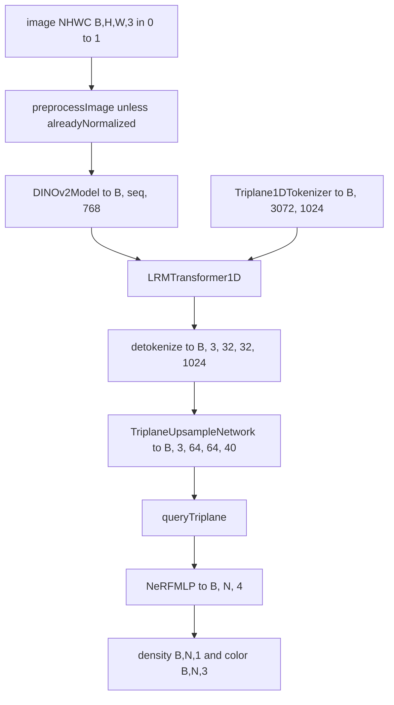

# Knowledge graph

Human index for [knowledge-graph.json](knowledge-graph.json).

`verified_commit` in [knowledge-graph.json](knowledge-graph.json) is informational. The checker hashes each cited range in the working tree and does not require that commit to be an ancestor of HEAD. If a cited range changes, update its lines, its `content_sha256`, and this page in the same commit. Standards: [engineering_standards.md](engineering_standards.md). Router: [AGENTS.md](../AGENTS.md).

No `actor` or `protocol` types are declared under `Sources/` or `Tests/`.

## Tensor dataflow

`forwardTriplanes` is `Sources/TripoSRRuntime/TripoSRModel.swift#TripoSRModel.forwardTriplanes`. `evaluate` is `Sources/TripoSRRuntime/TripoSRModel.swift#TripoSRModel.evaluate`. The CLI smoke batch is 1 (`Sources/TripoSRCLI/main.swift:211`).

## Where to find things

| Task | Location |
| --- | --- |
| Weight load and shape or unused-key checks | `Sources/TripoSRRuntime/TripoSRModel.swift#TripoSRModel.loadWeights` |
| ImageNet mean, std, and preprocess | `Sources/TripoSRRuntime/TripoSRModel.swift:53-62` |
| DINO forward and bilinear position resize | `Sources/TripoSRRuntime/DINOv2Model.swift:36-129` |
| Image to triplanes | `Sources/TripoSRRuntime/TripoSRModel.swift#TripoSRModel.forwardTriplanes` |
| Triplane sample | `Sources/TripoSRRuntime/TripoSRRenderer.swift#TripoSRRenderer.queryTriplane` |
| NeRF MLP | `Sources/TripoSRRuntime/NeRFMLP.swift#NeRFMLP` |
| CLI entry and `--parity` | `Sources/TripoSRCLI/main.swift:225-240` |
| Weight search order | `Sources/TripoSRCLI/main.swift#resolveWeights` |
| Parity dump; missing npy or weights throw | `Sources/TripoSRCLI/main.swift#runParityDump` |
| Smoke, 512 MiB cache, nonzero missing-weights exit | `Sources/TripoSRCLI/main.swift#runSmoke` |
| Published-weights test, load only | `Tests/TripoSRRuntimeTests/TripoSRRuntimeTests.swift:108-118` |
| Env var the test actually reads | `Tests/TripoSRRuntimeTests/TripoSRRuntimeTests.swift#tripoSRPublishedWeightsURL` |
| CLI nonzero-exit test | `Tests/TripoSRRuntimeTests/TripoSRCLIExitTests.swift:34-86` |
| Package manifest | `Package.swift:1-46` |
| macOS CI | `.github/workflows/ci.yml:16-58` |
| M3 Max numbers, as recorded, not re-run here | `README.md:116-142` |

Wiki: [01 Architecture](wiki/01-Architecture-and-Dataflow.md), [02 Weights](wiki/02-Weights-and-Parity.md), [03 Build and CI](wiki/03-Build-CI-and-Testing.md), [04 Memory](wiki/04-Memory-and-Performance.md).
